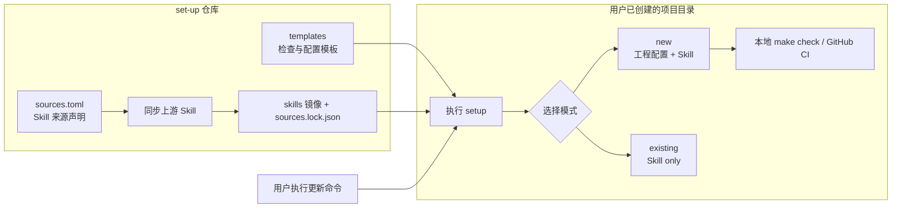
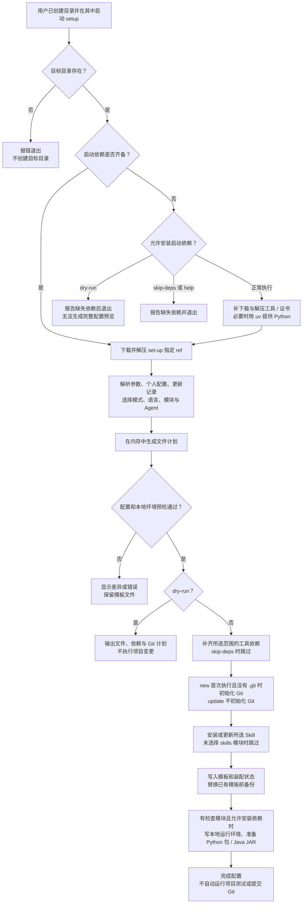
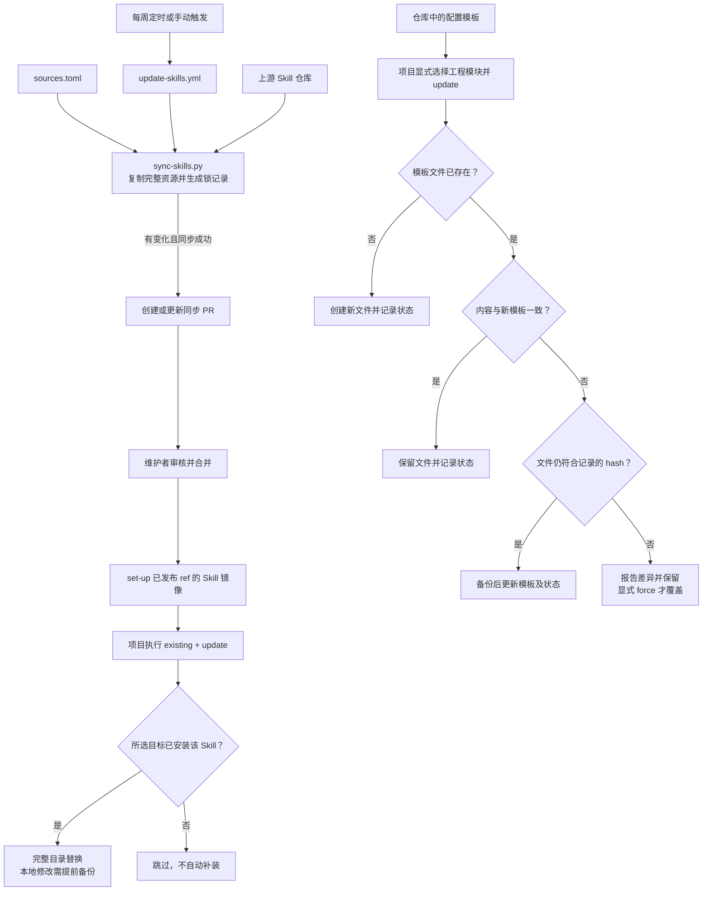
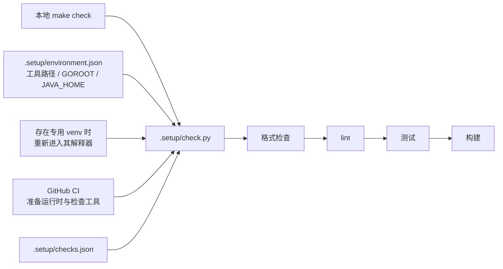

# 工作模型与流程图

set-up 是个人项目配置的装配工具：仓库集中维护模板和 Skill 来源，用户在目标项目目录执行入口，由脚本决定配置范围、准备依赖、安装内容并记录状态。

本文描述**当前工作区源码**，包括依赖自动补齐。远程一键入口执行的是 GitHub 指定 ref 的版本；尚未推送的本地改动不会自动生效。快速操作见 [README](../README.md)，参数细节见[使用手册](setup.md)，其他项目的 Agent 可只读[项目 Agent 指南](agent-setup.md)。

## 1. 全局工作模型

仓库承担两类工作：维护可分发的配置与 Skill，以及把这些内容装到用户项目。仓库里的自动同步不会主动修改已经配置好的用户项目。

### 用户、项目 Agent、维护 Agent 的职责

| 角色 | 负责什么 | 阅读入口 |
| --- | --- | --- |
| 用户 | 先建好目录，进入项目，选择模式和语言 | [README](../README.md) |
| 目标项目中的 Agent | 确认目标和授权范围，预览并代执行 setup，处理依赖提示和冲突 | [项目 Agent 指南](agent-setup.md) |
| 维护本仓库的 Agent | 修改脚本与模板、收录 Skill、维护验证和文档 | [AGENTS.md](../AGENTS.md) |

## 2. 一次 setup 的实际执行顺序

标准入口是 `scripts/setup.sh`，编排器是 `scripts/setup.py`。在已有工具仓库中直接调用 Python 入口，可跳过远程下载阶段，但仍执行配置选择、保护和项目依赖流程。

顺序有几个实际影响：

- 远程入口先准备能运行编排器的启动依赖，再生成工程文件计划。因此，后续发生模板冲突时，启动依赖可能已经装好。
- Python 编排器先预检模板冲突，再安装项目工具、初始化 Git 和安装 Skill；不会为了处理模板冲突先覆盖文件。
- Skill 安装先于模板落盘。如果 Skill 安装失败，后续模板阶段不会继续，但此前成功安装的 Skill 或工具可能保留。
- 模板和状态写入后才准备 Python 检查环境、安装项目 Python 依赖或下载 Java 检查 JAR。这一步失败会返回错误，已写入的配置不会整体回滚。
- “setup 完成”表示配置和所需准备步骤成功，不表示源码通过检查，也不表示远程 CI 已运行。

## 3. 配置如何决定执行范围

### 模式边界

| 行为 | new | existing |
| --- | --- | --- |
| 默认模块 | skills、gitignore、lint、makefile、ci | skills |
| 选择语言 | Go / Python / Java，可组合 | 不靠语言检测扩大范围 |
| Git 初始化 | 非更新执行且没有 `.git` 时执行 | 不执行 |
| 工程 lint、Makefile、CI | 按模块生成 | 不生成，显式指定工程模块会报错 |
| 依赖 | 启动依赖及所选模块的工具链 / 检查环境 | 仅启动与 Skill 复制所需工具 |
| Skill | 默认全部镜像条目，支持按 ID 筛选 | 同左 |

已有 `.git` 目录或 worktree 的 `.git` 文件会保留，不自动提交、不设置 remote、不改全局 Git 配置。两个模式都不创建项目目录或语言工程骨架。

### 参数、个人偏好与历史状态

显式命令行参数优先。默认个人偏好读取 `~/.config/project-setup/config.json`，也可用 `--config` 指定。更新时复用 `.setup/state.json` 中的记录，整体优先级为命令行、个人配置、更新记录、检测和默认值。

生成阶段还会保留已记录的语言，并为未指定的版本、Java 构建工具、Python 安装命令补充历史值。因此分次装配会累计语言和模块，不自动移除旧生成文件。

模式没有指定时：先采用能解析出的配置选择；显式模块含工程配置则推断为 new，仅 skills 则为 existing；其余情况下，有终端且不是更新时询问，非交互默认 existing。工程模板更新不能被理解为“永远只更新 Skill”，只更新 Skill 应显式使用 existing。

默认 Agent 为 Codex + Antigravity：

| 目标 | Skill 目录 |
| --- | --- |
| Codex | `.codex/skills/<ID>/` |
| Antigravity | `.agents/skills/<ID>/` |
| Claude Code | `.claude/skills/<ID>/` |

`--agents` 选择目标，`--only ID` 可重复筛选。统一入口和独立安装器的参数名不同：后者用 `--target`，旧 `both` 仍表示 Codex + Claude，不表示当前默认组合。

## 4. 依赖如何准备和使用

依赖分为启动运行时、系统工具、缓存工具和项目隔离环境。已有可用依赖尽量复用，缺失或不符合所需版本时补齐。

| 层次 | 内容 | 位置 / 使用方式 |
| --- | --- | --- |
| 启动运行时 | curl、tar、gzip、CA 证书；Python 3.11+ | 系统包管理器；Python 必要时由缓存的 uv 提供 |
| 系统工具 | Git、Make、JDK、Maven 等 | Linux 包管理器或 macOS Homebrew，可能需要管理员权限 |
| 用户缓存工具 | Go、golangci-lint、按需提供的 Python、Gradle | `${XDG_CACHE_HOME:-~/.cache}/set-up/`，不替换系统 Python |
| 项目本地环境 | Python launcher、工具路径、虚拟环境、Java JAR | `.setup/`，由生成的 gitignore 规则忽略设备相关文件 |

Go、golangci-lint、Gradle 的下载执行 SHA-256 校验；校验失败不执行解压安装，可有限重试。Go 缓存 SDK 同时记录对应 GOROOT，避免和设备旧 SDK 混用。Java 有 Maven / Gradle wrapper 时优先复用，不额外安装对应系统构建工具。

Python 检查包及配置指定的项目依赖安装到 `.setup/venv`。已有非 set-up 管理的同名环境会被保护，不直接清空。项目需要指定 Python 版本或系统解释器缺少虚拟环境支持时，可使用受管理 Python，不向系统 Python 执行 sudo pip。

设备必须先能取得入口脚本；连 curl / wget 都没有时，需要包管理器先安装初始下载工具，见[依赖引导](setup.md#依赖引导)。脚本不能替代网络、系统包仓库或管理员授权。

### 三个执行开关

| 方式 | 具体含义 |
| --- | --- |
| 正常执行 | 默认检测并补齐依赖，随后装配所选内容 |
| `--skip-deps` | 不安装依赖；所需启动工具和 Git 等执行条件应已满足。仍会按所选模块安装 Skill、写模板，new 仍可能初始化 Git |
| `--dry-run` | 只生成计划，不安装依赖、不初始化 Git、不写项目文件、不下载 Skill；远程引导器本身仍会下载 set-up 归档 |

启动依赖不齐时，远程 dry-run 只能报告缺失项并退出，不能提供完整工程文件计划。独立 Skill 安装器的 dry-run 会下载归档，行为与统一编排器不同。

## 5. 文件记录与保护模型

| 文件 / 目录 | 作用 | 更新策略 |
| --- | --- | --- |
| `sources.toml` | 本仓库维护的 Skill 来源声明 | 维护者登记 |
| `sources.lock.json` | 本仓库镜像对应的 commit/hash | 仅由同步脚本生成 |
| `skills/` | 本仓库的上游 Skill 镜像 | 同步脚本替换，不直接编辑上游内容 |
| 项目的 Agent Skill 目录 | 项目已安装的独立副本 | 更新时整目录替换 |
| `.setup/state.json` | 模块、语言、选择、模板 hash 和版本 | 用于识别受管理模板和本地修改 |
| `.setup/checks.json`、`.setup/check.py` | 检查配置与共用执行入口 | 按模板保护规则维护 |
| `.setup/environment.json`、`.setup/python`、`.setup/env.sh` | 本设备的运行环境与工具路径 | 本地依赖阶段生成 / 复用，不是可移植工具链本体 |
| `.setup/venv/`、`.setup/tools/` | Python 检查环境、Java 检查 JAR | 复用或补齐，不应作为源码共享 |
| `.setup/backups/` | 替换模板前的文件备份 | 保留供审阅恢复 |

普通模板内容不一致时默认报冲突；`--update` 只自动替换仍符合上次记录 hash 的受管理模板。本地已修改的文件保留并显示差异；`--force` 才显式覆盖。内容本来一致的文件不重复改写。

`.gitignore` 按管理区块合并，保留区块外内容；管理区块被修改时也检查冲突。Skill only 安装由独立安装器补 Agent 忽略项，组合装配时由 gitignore 模块统一处理。

Skill 与模板的保护规则不同：Skill 更新整目录替换，包括删除上游已移除的文件，不按模板 hash 合并，也不自动享有模板备份。重复运行“安装”遇到已安装 Skill 默认报错，应根据意图改用更新，而不是无条件强制覆盖。

## 6. 两层 Skill 更新与模板更新

仓库的 `update-skills.yml` 配置为每周一 03:00 UTC 及手动触发，执行上游同步并创建 PR，不直接推送主分支。它读取来源清单和锁记录，不解析 README 的表格，不依赖本页流程图。

项目更新是另一次明确执行：安装器下载所选 set-up 仓库 / ref，再按来源清单和目标过滤复制镜像。它不直接到各上游仓库查找最新版，也不自动给所有已配置项目推送内容。同步 PR 尚未合并到所选 ref 时，项目更新不会拿到该 PR 中的版本。

裸 `--update` 可以复用已有模式和模块记录；**只更新 Skill 应使用 `--mode existing --update`**。工程模板更新显式选择 `--mode new --modules gitignore,lint,makefile,ci --update`，并按需要指定语言和版本，详见[更新与冲突处理](setup.md#更新与冲突处理)。

## 7. 配置之后：本地与 CI 如何复用检查

CI 在选择 Makefile 模块时也通过 Make 目标进入共用入口；独立选择 CI 时直接调用入口。CI 自行准备运行时和检查工具，不依赖某台开发设备的 `.setup/venv` 或缓存路径。

| 语言 | 格式 | lint | 测试与构建 |
| --- | --- | --- | --- |
| Go | gofmt | golangci-lint v2，含正确性、长度和复杂度检查 | go test / go build |
| Python | Ruff format | Ruff check | pytest；有包元数据时调用 build |
| Java | google-java-format | Checkstyle | 现有 Maven / Gradle 工程与 wrapper |

默认长度与复杂度阈值及官方依据见 [lint 策略](lint.md)。

`check` 不修正源码格式，`format` 才修改源码。多语言项目可通过 `SETUP_LANGUAGE` 或检查入口的 `--language` 筛选，任一步失败会返回非零状态，不继续后面的步骤。无 Python 包元数据时跳过构建，无测试时保留 pytest 的非零结果。

## 8. 失败、恢复与范围边界

整个 setup **不是跨步骤事务**。启动包、工具缓存、Git 初始化、已成功复制的 Skill 和已写入的模板，可能在后续步骤失败后保留。不要把失败理解为项目回到执行前状态，也不要把状态文件存在当作全部依赖安装成功。

处理方式是先看失败阶段，修复网络、权限、工具版本或文件冲突，再用相同范围重试；Skill 已存在时按实际意图选择更新，不为消除报错直接强制覆盖。缓存和本地环境可复用，但不会自动卸载系统包或删除旧模块。

当前不负责生成业务代码、go.mod / pyproject.toml / Maven / Gradle 工程骨架，不安装 Code Agent 客户端，不登录账号，不执行上游 Skill 的指令来猜测依赖。统一入口也不自动安装 OpenSpec CLI。支持的系统、已知权限要求及工具版本以[使用手册](setup.md)和当前脚本为准。

工作模型变更时，维护者应同时核对入口、配置顺序、依赖边界、状态记录和更新策略，再调整本页图示；不要只修改图中的“成功”路径而遗漏预览、冲突和部分失败。
